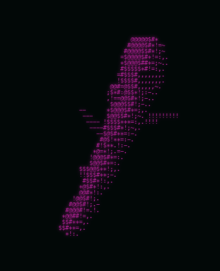

# Conta Bastone



Serve per il traversone: tiene il conto dei bastoni e dei cappotti di ogni giocatore.

Online su https://conta-bastone.gabriele-martire.workers.dev

## Come si usa

- Tocca un giocatore per dargli un bastone.
- Tieni premuto per togliere un punto o eliminarlo.
- Con `⇄ CAPPOTTI` passi al conto dei cappotti.

Chi apre il sito senza chiave può solo guardare. Per modificare serve il link con la chiave: `/#k=LA_TUA_CHIAVE`.

## Com'è fatto

Una pagina HTML, un Cloudflare Worker e un database D1.

```sh
npm run dev      # in locale
npm run deploy   # online
```

Se ti piace, lascia una stella.
